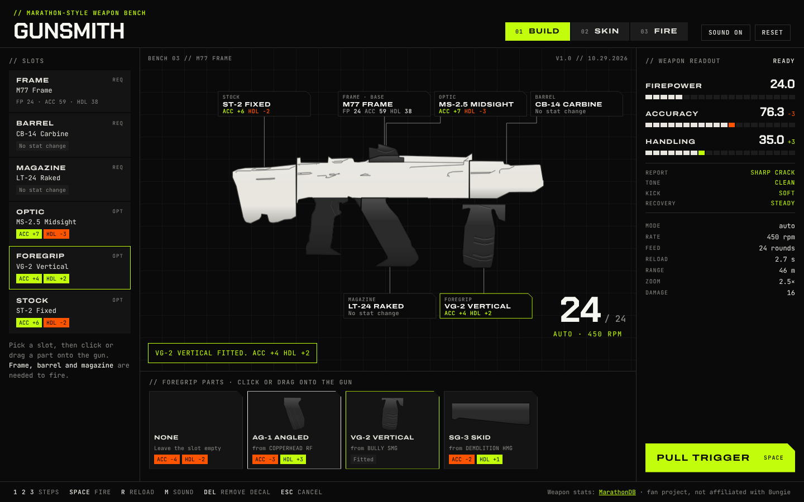
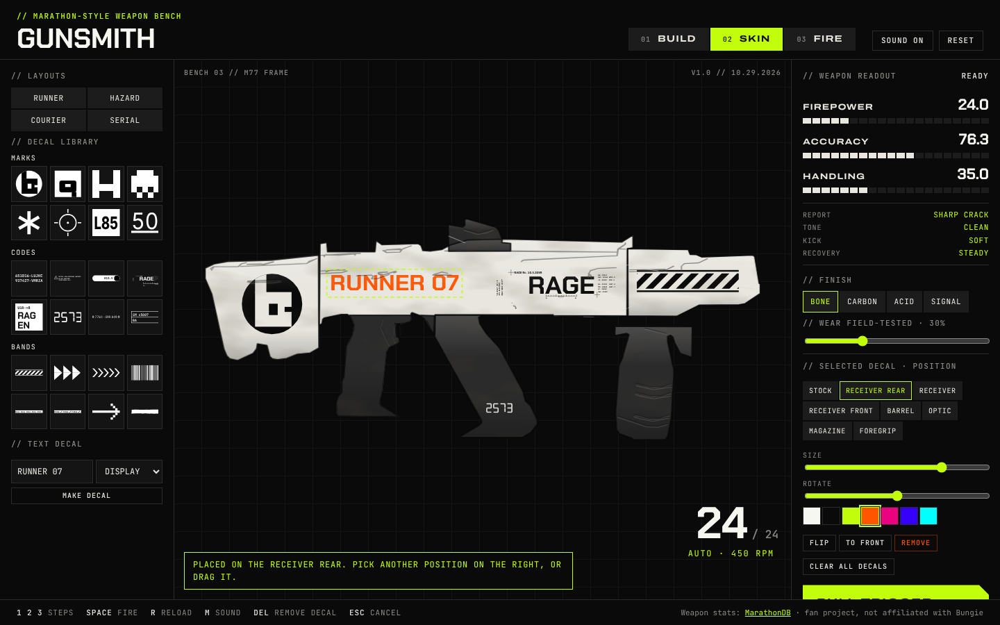
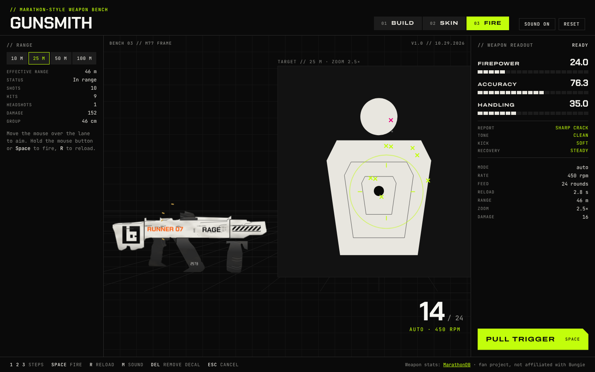

# Gunsmith

A Marathon-style weapon bench in the browser. Snap a gun together from parts, cover it in decals and wear, then pull the trigger and hear and feel what you built.


**Live version:** https://andyzhoua2222.github.io/Assignment3-marathon/ (GitHub Pages, deployed from `main`).
A longer recording is in [`docs/demo.webm`](docs/demo.webm).

## The idea

Loadout screens in shooters show three bars (Firepower, Accuracy, Handling) and ask you to trust that a longer barrel "feels" different. Gunsmith makes that link audible and physical. Every part moves the three numbers, and the numbers drive a synthesised gunshot and a spring-based recoil model, so swapping a stubby barrel for a long one changes the shot from a light snap with a fast rattle into a deeper, slower report with a calmer recovery.

The look follows the visual language of Bungie's *Marathon*: black, bone white, one acid-green accent, hard cut corners, monospaced data labels and dense graphic decals.

## Who it is for

People who play extraction shooters and enjoy tinkering with loadouts and weapon skins, and design students curious about how game UI connects numbers to feel. No game knowledge is needed: every part card says what it changes before you fit it.

## The main interaction

The loop is **pick a part → it snaps on → the numbers, sound and feel change → pull the trigger to check**. Three steps, switchable at any time:

| Step | You do | The bench responds |
|---|---|---|
| **01 Build** | Pick a slot, then click or drag a part card onto the gun | The part slides into its socket with a clack. Every fitted part is labelled on the bench with what it adds to Firepower, Accuracy and Handling, and the slot list shows the same. Hovering a part, its label or its slot lights that part up and shows its share on the stat bars; clicking it opens its slot. While you hover a part card, the bars preview the change in green and orange and the readout words (Report, Tone, Kick, Recovery) update. Parts that don't fit stay visible but greyed, with the reason. |
| **02 Skin** | Apply a layout (Runner, Hazard, Courier, Serial) or click decals in the library, or type a callsign; pick a position for the selected decal or drag it; choose a paint finish and drag the wear slider | A new decal lands on a free flat area of the gun, sized to fit. The position buttons (stock, receiver rear, receiver, receiver front, barrel, optic, magazine, foregrip) list the areas the current build has and outline each one on hover. Decals are clipped to the gun's silhouette. Wear chips the paint to show bare metal, adds grime and scratches, and the decals wear with the paint. |
| **03 Fire** | Aim over the lane and hold the mouse button or Space; press R to reload | Shots land on the target with spread, sway and muzzle climb from the stats. The gun kicks back on a spring, casings fly, the counter drops, and an empty magazine gives a report of shots, hits, damage and group size. |

You can pull the trigger in any step. Firing an unfinished gun jams and takes you to the missing slot.

**Going back, resetting, stopping:** the step buttons (or keys 1, 2, 3) move freely between steps without losing anything. Every slot has a *None* card to take a part off. *Reset* (click twice) clears the bench, *Clear all decals* (click twice) clears the skin, Delete removes the selected decal and Esc deselects it. Applying a layout over your own decals asks for a second click. *Sound on/off* (or M) mutes. The bench is saved in the browser, so a reload brings it back.

### How the three stats become sound and feel

All three are normalised to 0–1 in [`src/parts.js`](src/parts.js) and mapped in [`src/feel.js`](src/feel.js):

| Stat | Sound | Feel |
|---|---|---|
| **Firepower** | Lower and longer thump, louder body, bigger room tail | Bigger kick back and muzzle climb, screen shake, larger flash |
| **Accuracy** | Tighter, brighter crack and fewer stray echoes (ragged at low accuracy) | Smaller first-shot cone and less bloom per shot, less climb |
| **Handling** | The mechanism clicks sooner and brighter after each shot | Stiffer recoil spring (the gun settles faster), less idle sway, faster reload |

The frame sets the base numbers and the firing mode (auto, semi or a five-round burst). Parts add or subtract from there, so the same frame can become a twitchy close-range gun or a slow, steady long-range one.

### One action, traced through the code

Holding the mouse button on the range calls `press()` in [`src/range.js`](src/range.js) (line 38). It checks the gun is complete (otherwise `jam()`), ignores presses faster than the frame's fire rate, then calls `fireOne()` (line 60). `fireOne()` takes a round, plays `sfx.shot(snd)` from [`src/audio.js`](src/audio.js) with the sound settings `soundParams(stats)` worked out from the three stats, adds a recoil impulse sized by `feelParams(stats)`, and calls `shootDownrange()` to place the hit. The per-frame `tick()` (line 117) then pulls the gun back to rest with a spring whose stiffness and damping come from Handling, and keeps firing while the button is held on automatic frames.

## Run it

It is a static site with no build step and no runtime packages. Browsers block JavaScript modules on `file://` pages, so serve the folder with any static server and open the address it prints. With Python 3 (built into macOS and most Linux):

```sh
git clone https://github.com/AndyZhouA2222/Assignment3-marathon.git
cd Assignment3-marathon
python3 -m http.server 8000
# open http://localhost:8000/
```

Other ways that work the same:

```sh
uv run python -m http.server 8000   # with uv
npx serve .                         # with Node.js
```

Opening `index.html` directly shows a message explaining this instead of a blank page.

Use a current desktop Chrome, Edge, Firefox or Safari. The page loads its typefaces from Google Fonts; offline it falls back to system fonts and still works.

### Tests and screenshots (optional, for development)

```sh
npm test            # Node 18+: 23 tests for the part rules, stat model, feel mapping and decal positions (no install needed)
npm install         # only for the screenshot tool (playwright-core)
npm run shots       # rewrites docs/*.png and docs/demo.gif; needs Chrome and ffmpeg
```

### Redrawing the parts (optional)

The part outlines in `src/data/traced-shapes.js` are generated from weapon renders, which are not in this repository. With a folder of renders laid out as in [`tools/trace/config.json`](tools/trace/config.json) (one sub-folder per weapon), and Python with numpy, opencv-python-headless and Pillow:

```sh
python3 tools/trace/trace.py path/to/renders --preview out/trace   # rewrites src/data/traced-shapes.js
```

For each weapon the script flips the render so the muzzle points right, levels it, cuts it into the parts listed in the config, simplifies each outline to a polygon and scales it to bench units. It also keeps the long, straight edges inside each part as panel lines, and finds the largest flat rectangle in each part, which becomes that part's decal position. `--preview` saves an overlay per weapon showing where it cut.

## Controls

| Key | Action |
|---|---|
| 1 / 2 / 3 | Build / Skin / Fire |
| Space (hold) or mouse button on the lane | Fire |
| R | Reload |
| M | Sound on or off |
| Delete | Remove the selected decal |
| Arrow keys | Nudge the selected decal (Shift for bigger steps) |
| Esc | Deselect the decal |

Part cards and the trigger button also work with Tab and Enter.

## Mistakes and interruptions it handles

- **Firing an unfinished gun:** the trigger jams with a dry click, names the missing part and jumps to its slot.
- **A part that doesn't fit:** a magazine for the wrong ammo, a stock on the pistol frame, or a foregrip on a barrel without a rail is refused with the reason, and the card stays greyed. Swapping a frame or barrel takes off parts that no longer fit and says which.
- **Repeated clicks:** pressing faster than the gun's fire rate is ignored with a "Cycling" note, presses during a reload are ignored, and reloading a full magazine says so. Reset and Clear all ask for a second click.
- **Empty magazine:** dry fire, "Empty · press R", and a magazine report.
- **Empty or invalid text decal:** an inline error with a shake; nothing is added. Decals are capped at 30, with a message.
- **A layout over decals you placed:** the layout button asks for a second click before replacing them.
- **A build without a part:** decal positions only list areas the current build has; layouts skip positions it lacks.
- **No sound available** (no Web Audio, or blocked): a one-time notice; everything else keeps working and the sound button shows "No sound".
- **Storage blocked or saved data damaged** (private mode, an old save): the bench starts fresh instead of failing.
- **Opened from the file system or with JavaScript off:** a page explaining how to serve it.
- **Fonts unavailable:** system fallbacks.

## Project layout

```
index.html                 page structure
css/gunsmith.css           Marathon-style tokens and layout
src/app.js                 state, build step, part tray, drag and drop, keyboard
src/parts.js               part library, sockets, compatibility rules, stat model (no DOM)
src/feel.js                stats → sound and feel settings (no DOM)
src/audio.js               Web Audio synthesis of shots, dry fire, reload
src/gun-svg.js             draws the assembled gun: finish, wear, decals
src/skin.js                decal library, placing and editing decals, finish and wear
src/range.js               firing range: trigger, recoil springs, hits, reload
src/lib/decal-kit.js       decal and text generator (from this repo's earlier decal kit)
src/data/marathondb-weapons.js   weapon stats snapshot from MarathonDB
src/data/traced-shapes.js  part outlines traced from weapon renders (generated)
tests/                     node:test tests
tools/screenshot.mjs       captures the README images
tools/trace/               tracing script and the config saying how each weapon is cut into parts
docs/                      screenshots and recordings
```

## Screenshots

| Build | Skin | Fire |
|---|---|---|
|  |  |  |

## Known limitations

- **Part shapes are flat traced outlines.** Each part is traced from a render of the weapon it comes from and simplified to a polygon, then drawn in two tones (paint, and dark polymer for grips, magazines and sights). Panel lines are the long, straight edges the tracing tool finds inside each render, so a few marks from the skins' printed artwork slip through and small details are missing. Parts keep the attachment point of their own weapon, so a part from a much larger or smaller gun can look oversized on another frame. Two pieces are drawn by hand: the iron sights (they stretch to the rail) and the Magnum's grip magazine (only its base plate shows).
- **The WSTR shotgun and the Magnum pistol have no stock mount**, because the renders show none.
- **Only the frames' base numbers are real data** (a MarathonDB snapshot from 29 October 2026). The part modifiers are invented to make the trade-offs readable. MarathonDB has no accuracy value for the WSTR shotgun, so 35 is an estimate.
- **The sound is synthesised**, not recorded. It is built to make differences between builds obvious, not to sound like the real game. Phones on silent may mute it.
- **Side view only:** decals go on the one visible side of the gun.
- **Desktop first.** On a narrow screen the panels stack and the bench works with touch, but it has only been checked in an emulated phone-sized window, not on a real phone. On touch, press and hold the lane to fire (aiming follows the finger), and the keyboard shortcuts are unavailable.
- The saved bench lives in this browser only.

## Credits

- **Weapon names and base stats:** [MarathonDB](https://marathondb.gg/weapons/), a community database, via its public API.
- **Part outlines** are traced from weapon renders shown on MarathonDB (the weapon art is Bungie's). The renders were used only as a tracing reference and are not included in this repository.
- **Visual style** inspired by Bungie's *Marathon* ([marathonthegame.com](https://marathonthegame.com/)). No game images, logos, screenshots or audio are included. *Marathon* is a trademark of Bungie. This is a non-commercial student project, not affiliated with or endorsed by Bungie.
- **Decal generator:** `src/lib/decal-kit.js`, compiled from the Marathon decal kit made earlier in this repository (see the commit history).
- **Fonts:** Chakra Petch, Archivo, JetBrains Mono, Inter and Instrument Serif from [Google Fonts](https://fonts.google.com/) (SIL Open Font License). If the game's own typefaces are installed on your computer the page uses them instead; they are not included.
- **Tools:** [Playwright](https://playwright.dev/) for screenshots, [ffmpeg](https://ffmpeg.org/) for the GIF.
- **AI assistance:** written with Claude Code; [PROCESS.md](PROCESS.md) says what for.
